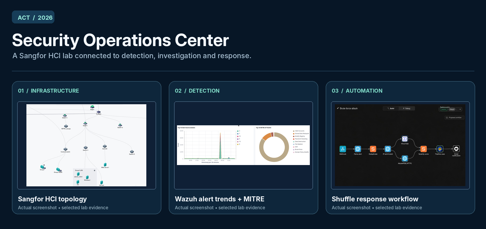
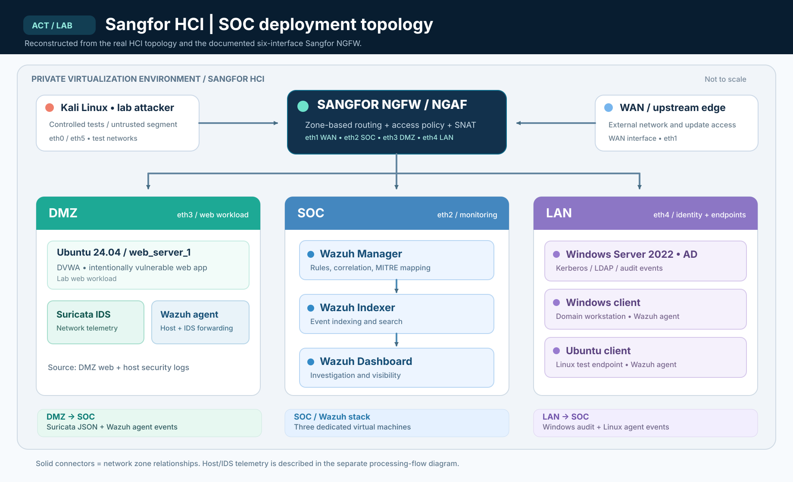
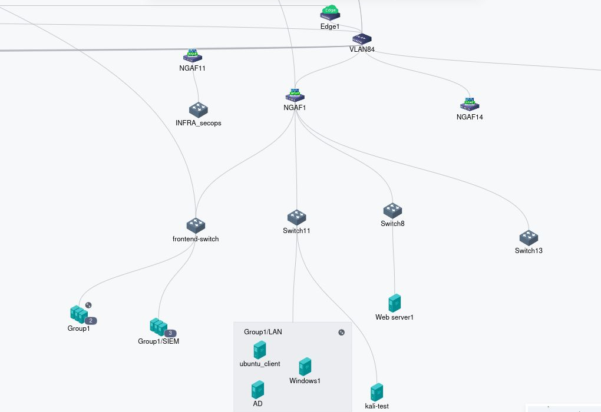
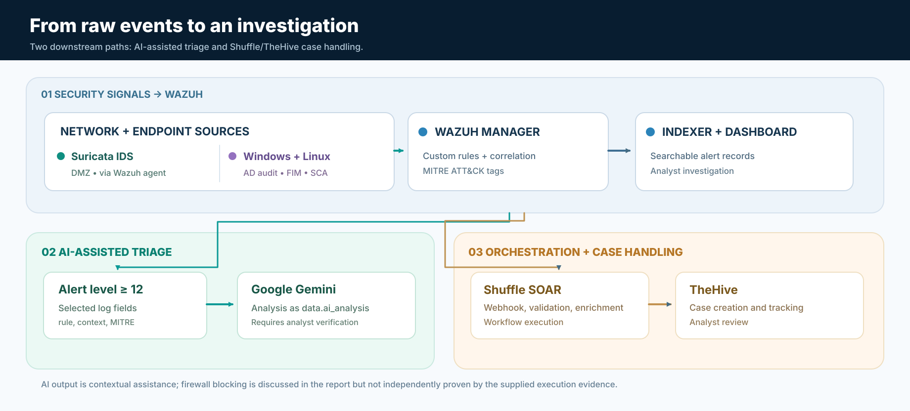
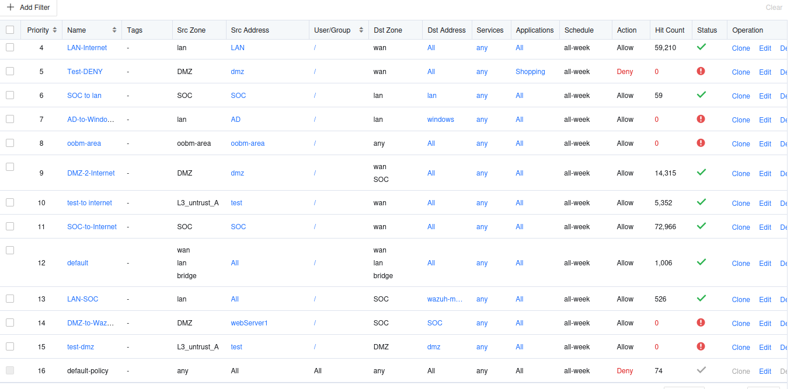
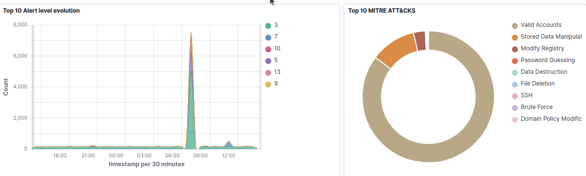
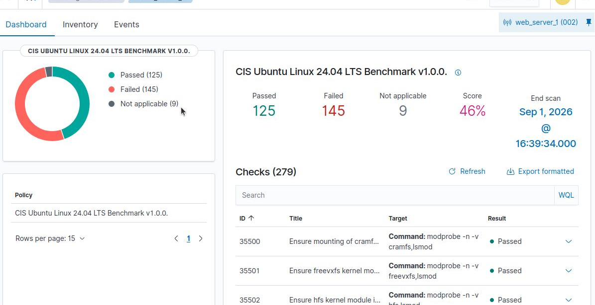
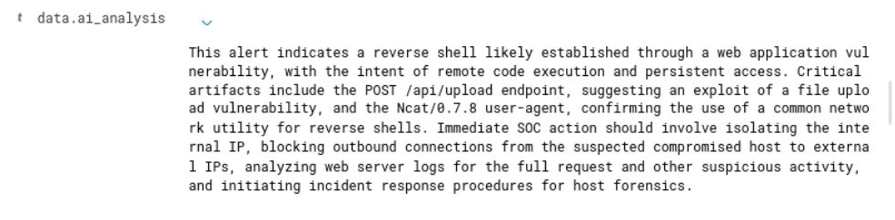
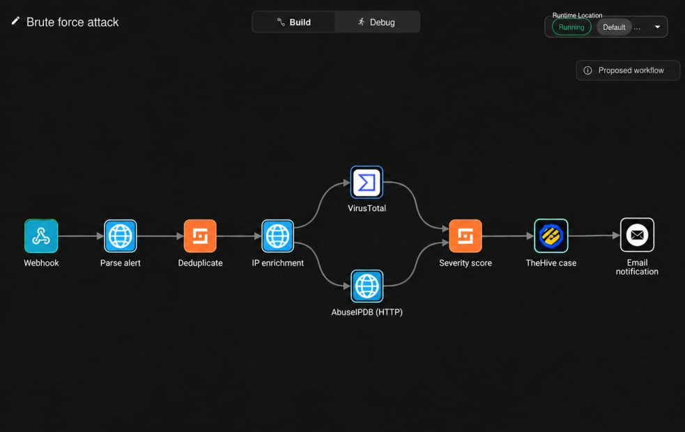
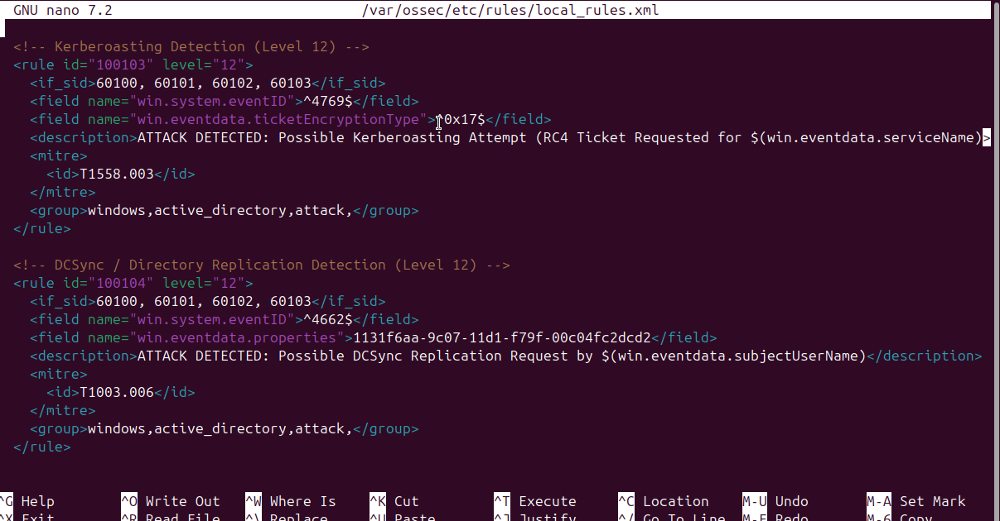

<div align="center">

# ACT Security Engineering Internship

**Detection engineering · Network segmentation · AI-assisted triage · SOAR workflows**

Security Engineering Internship at **Advanced Computer Technology (ACT)**  ·  Tunis  ·  **June–September 2026**

</div>



> **The project in one sentence:** I built a SOC proof of concept on Sangfor hyperconverged infrastructure, connected host and network security telemetry to Wazuh, tested detections against an isolated lab, and explored how AI and SOAR could support incident triage.

[Architecture](#architecture--how-the-soc-was-built) · [Implementation](#what-i-built) · [Attack tests](#attack-scenarios--detections) · [Evidence](#evidence-from-the-real-lab) · [Results](#results--what-the-numbers-mean) · [Technical notes](#technical-documentation)

---

## Why I built this

A security alert is only useful when the analyst can answer three questions: **what happened, where did it happen, and what should happen next?** During my internship, I worked on that problem end to end, starting with a segmented network and ending with a security event visible in a dashboard or an incident workflow.

The environment was a **controlled proof of concept running on ACT's private Sangfor HCI**, not a production SOC or a public-cloud deployment. I worked with a vulnerable web application and an Active Directory test domain so I could generate known events, examine the logs, and build detection and response logic around them.

### Project at a glance

| **~31.8 million** | **31,641** | **5 enrolled / 4 active** | **46%** |
|:---:|:---:|:---:|:---:|
| Events visible in Wazuh | Alerts at severity level ≥ 12 | Wazuh agents in snapshot | Ubuntu CIS benchmark baseline |

*These are recorded lab dashboard metrics, not counts of confirmed intrusions or improvements in detection accuracy.*

## Architecture — how the SOC was built



**Figure 1 — Deployment topology**, reconstructed from the actual Sangfor HCI view and the six NGFW interfaces documented in the report. Zones, assets, and Wazuh component roles reflect the lab. The drawing is a documentation diagram, not an unmodified HCI console export.

The Sangfor NGFW connected the **WAN**, **DMZ**, **LAN**, **SOC**, and two **untrusted/test** networks. The **DMZ** hosted an Ubuntu/DVWA test web server, with **Suricata** monitoring traffic and a **Wazuh agent** collecting host and IDS events. The **LAN** contained a Windows Server 2022 domain controller and Windows/Ubuntu endpoints. The **SOC zone** hosted the Wazuh **manager, indexer, and dashboard on three dedicated VMs**.

<details><summary><strong>See the original Sangfor topology screenshot</strong></summary>



*Figure 2 — Original ACT lab capture (cropped to the topology area). The screenshot shows the NGFW and virtual switches as represented in the HCI console.*

</details>



**Figure 3 — Event processing flow.** Wazuh receives host and Suricata data. High-priority alerts can be enriched through Gemini, while alert webhooks can trigger Shuffle/TheHive case workflows. These are separate downstream paths, not a single mandatory serial chain.

More detail: [Network and data flows](docs/architecture.md) · [AI and orchestration](docs/automation-and-ai.md).

## What I built

| Workstream | My implementation | Evidence |
|---|---|---|
| **Virtual network + NGFW** | Mapped six Sangfor NGFW interfaces to security zones; configured network objects, access rules, admin roles and outbound SNAT. | [Zone interfaces](screenshots/02-ngfw-security-zones.png) · [Firewall policy](screenshots/03-ngfw-firewall-policy.png) |
| **Security monitoring** | Deployed a three-component Wazuh stack; connected Windows/Linux agents and Suricata IDS alerts from the DMZ. | [Wazuh charts](screenshots/04-wazuh-attack-dashboard.png) |
| **Detection engineering** | Tested Wazuh rules for Kerberoasting indicators and simulated DCSync-like directory access, mapped to MITRE ATT&CK. | [Rule output](screenshots/09-custom-ad-detection-rules.png) · [Kerberos test](screenshots/10-kerberos-test-evidence.png) |
| **Configuration assessment** | Ran Wazuh SCA against CIS Ubuntu 24.04 LTS and reviewed the failed checks as a hardening baseline. | [CIS dashboard](screenshots/05-cis-ubuntu-assessment.png) |
| **AI-assisted alert analysis** | Connected selected high-severity Wazuh alerts to Google Gemini; surfaced generated notes in `data.ai_analysis`. | [AI output in Wazuh](screenshots/06-gemini-ai-analysis.png) |
| **Incident orchestration** | Designed Shuffle alert-handling paths with IP enrichment, severity assessment, TheHive case actions, and notification steps. | [Shuffle workflow](screenshots/07-shuffle-enrichment-workflow.png) |

## Attack scenarios & detections

Rather than showing only installed tools, I validated the telemetry against **controlled attacks in an isolated lab**.

| Scenario | What I exercised | Signal observed / detection idea | MITRE ATT&CK |
|---|---|---|---|
| **Brute-force authentication** | Multiple test login attempts using Hydra | Wazuh authentication failures; documented Shuffle brute-force workflow | **T1110** |
| **Web application compromise** | DVWA file upload, web shell and reverse-shell lab | Suricata IDS + Wazuh web-shell alerts; reverse-shell session shown in report | **T1505.003**, **T1059** |
| **Kerberoasting indicators** | Kerberos service-ticket request in AD test domain | Windows **4769**, RC4 `0x17` → custom Wazuh rule **100103** | **T1558.003** |
| **DCSync-like activity** | LDAP-based *simulation* of suspicious directory access | Windows **4662** → custom Wazuh rule **100104** | **T1003.006** |

**Important validation boundaries:** the DCSync scenario simulated an LDAP access pattern rather than performing real directory replication. One highlighted Suricata alert for a possible reverse shell points to the Wazuh manager's address; that network event alone is **not proof of the reverse-shell session**. See [Attack tests and detection limitations](docs/detections-and-attack-scenarios.md).

## Evidence from the real lab

The following are **actual screenshots**, cropped from the files supplied with the internship report. No generated UI is represented as a security product screenshot.

### 01 / Network security — Sangfor NGFW



The policy snapshot captures permitted inter-zone paths, test rules and a final deny rule. It also contains a broader allow rule earlier in the table, so the screenshot **should not be treated as proof of a fully least-privilege policy** without checking rule order and hit behavior.

### 02 / Monitoring — Wazuh + MITRE ATT&CK



The threat-hunting view shows a pronounced alert spike during a testing window and a distribution of ATT&CK tags. A dashboard classification is a starting point for investigation, not a confirmed incident count.

### 03 / Baseline hardening — CIS Ubuntu 24.04



**125 passed / 145 failed / 9 not applicable — 46% score.** This is a *baseline assessment*, not a claim that I remediated the failed checks or improved the score.

### 04 / Analyst assistance — Gemini enriched alert



A model-generated description of a suspected web compromise appeared under **`data.ai_analysis`**. Its recommended actions are hypotheses that analysts should validate against the original host/network logs before containment.

### 05 / Incident workflow — Shuffle and TheHive



This capture shows **Webhook → Parse alert → Deduplicate → IP enrichment → VirusTotal/AbuseIPDB → Severity score → TheHive case → Email notification**. It proves the *workflow layout*, not independent completion of every action. The report's brute-force response workflow also describes firewall IP blocking, but other report sections leave that completion unclear; I do not count it as independently verified containment.

### 06 / Detection rules — Active Directory



Two Wazuh custom detection rules target **Kerberoasting indicators** (`100103`) and **replication-related directory access** (`100104`). The original editable `local_rules.xml` was not among the supplied files, so I have not fabricated an XML export.

See [the complete screenshot index](docs/evidence-index.md) for provenance and additional evidence.

## Results — what the numbers mean

| Metric recorded in the internship report | Value | Reading |
|---|---:|---|
| Events ingested / visible in Wazuh | **~31.8M** | Aggregate test-period telemetry |
| Wazuh level ≥12 alerts | **31,641** | Alert records, not unique incidents |
| Authentication failures | **2,445** | Aggregated during the test period |
| Authentication successes | **8,750** | Dashboard context; not successful attacks |
| Registered / active Wazuh agents | **5 / 4** | Lab snapshot |
| Web-shell dashboard example | **486** | Subset / specific test window |
| CIS Ubuntu 24.04 baseline | **46%** | 125 passed, 145 failed, 9 N/A |

This PoC demonstrated a functional **detection → analysis → case handling** design. 

## Technical documentation

| Document | Contents |
|---|---|
| [Architecture and data flows](docs/architecture.md) | Sangfor virtual networks, zones, telemetry and policy caveats |
| [Detection rules and attack tests](docs/detections-and-attack-scenarios.md) | Brute force, DVWA/web shell, Kerberoasting, simulated DCSync |
| [Automation and AI](docs/automation-and-ai.md) | Gemini enrichment and Shuffle/TheHive workflow evidence |
| [Results and limitations](docs/results-and-limitations.md) | Observed metrics versus what the test can actually prove |
| [Evidence index](docs/evidence-index.md) | Screenshot provenance and scope |
| [Reproduction notes](docs/reproduction-notes.md) | How to recreate the design in an authorized isolated lab |
| [Publication checklist](docs/publication-checklist.md) | What to review before publicly sharing employer-owned evidence |

### Technology stack

`Sangfor HCI` · `Sangfor NGFW / NGAF` · `Wazuh` · `Suricata` · `Windows Server 2022` · `Active Directory` · `Ubuntu 24.04` · `Kali Linux` · `MITRE ATT&CK` · `CIS Benchmark` · `Gemini API` · `Shuffle` · `TheHive` · `VirusTotal` · `AbuseIPDB`

### Repository contents

```text
ACT-Security-Engineering-Internship/
├── README.md
├── assets/
│   ├── project-evidence-cover.png         # Made from actual uploaded screenshots
│   ├── infrastructure-topology.svg        # Detailed, editable architecture
│   ├── detection-response-flow.svg        # Separate alert flow diagram
│   ├── infrastructure-topology.png        # PNG preview
│   └── detection-response-flow.png        # PNG preview
├── screenshots/                            # 11 original-source evidence captures
├── docs/                                   # Technical case-study notes
└── tools/
    └── README.md                          # Diagram and source maintenance
```

**Source availability:** this is a **documented internship case study**, not a one-command installer. Proprietary Sangfor configurations, Wazuh rule XML, real API credentials and original workflow JSON were not supplied and are not invented here.

<details><summary><strong>Disclosure and responsible sharing</strong></summary>

Screenshots and configuration details originate from an internship environment and should be published only with ACT's authorization. IP addressing was excluded from the selected public-oriented firewall-interface screenshot; a Docker Swarm capture containing a join token was deliberately excluded. The original PDF report is not committed. Review the [publication checklist](docs/publication-checklist.md) before publishing.

</details>

---

*Built during a Security Engineering internship at Advanced Computer Technology (ACT), 2026. Documentation and architecture redrawn from the author's original report and lab evidence.*
