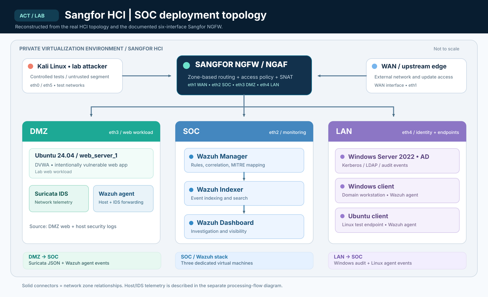
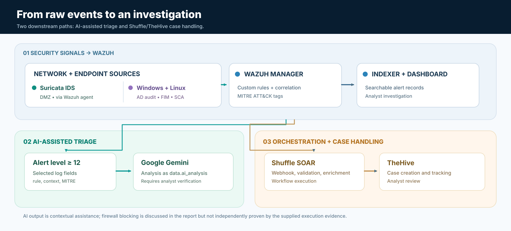

# Architecture | ACT Sangfor HCI SOC

The infrastructure diagram is a **redrawn, editable representation of the actual lab** documented in the internship report. The source-of-truth UI capture is `../screenshots/01-hci-topology.png`. The conceptual event diagram is separate to avoid confusing network topology with orchestration.

## Six NGFW interfaces and security zones

| Interface | Documented zone | Lab subnet (from report) | Role |
|---|---|---|---|
| `eth0` | `L3_untrust_A` | `192.168.10.0/24` | Controlled test/transition network |
| `eth1` | `WAN` | `172.23.84.0/24` | External connectivity / updates |
| `eth2` | `SOC` | `172.23.50.0/24` | Dedicated monitoring network |
| `eth3` | `DMZ` | `10.10.10.0/24` | Ubuntu web / DVWA / Suricata |
| `eth4` | `LAN` | `10.10.20.0/24` | Active Directory and clients |
| `eth5` | `L3_untrust_B` | `102.103.104.0/24` | Additional test/transition interface |

*Exact lab subnets are provided here solely to explain the report's architecture. Review ACT publication permissions before sharing any employer network information publicly.*

## Monitored lab assets

| Zone | Asset | What it provided |
|---|---|---|
| SOC | Wazuh manager, indexer, dashboard (three Ubuntu VMs) | Correlation, storage/search, dashboard |
| DMZ | Ubuntu 24.04 / `web_server_1` with DVWA | Deliberately vulnerable test web workload |
| DMZ | Suricata IDS + Wazuh agent | Network + host telemetry, forwarded into Wazuh |
| LAN | Windows Server 2022 (`labad.local`) | AD domain services and Windows audit events |
| LAN | Windows client / Ubuntu client | Domain and Linux testing endpoints |
| Untrusted | Kali Linux | Authorized offensive simulation |

## Event path, step by step

1. Wazuh agents on test systems forward endpoint logs, audit and FIM/SCA events to the manager in the SOC zone.
2. Suricata on the web-server host emits IDS JSON alerts, which the Wazuh agent forwards to the manager using an allowed DMZ-to-SOC path.
3. Wazuh manager evaluates rules, assigns severity and ATT&CK metadata, then writes results for querying in the indexer/dashboard.
4. A separate enrichment mechanism sends selected high-severity alert context to Google Gemini and stores the textual result as `data.ai_analysis` for analyst review.
5. Selected alerts can trigger Shuffle webhooks and TheHive case creation. The separate screenshot of the IP-enrichment workflow illustrates a designed path; successful NGFW API blocking is not independently verified by the shared evidence.

## Security policy caveat

The rule table contains a final `default-policy` deny, but also an earlier broad allow rule. The report's principle of least privilege is a **design intent**; a full effective-policy audit would be required before claiming strictly enforced network-wide deny-by-default.

## What changed between the actual screenshot and these drawings?

- I made the functional zones and components legible at README width.
- I omitted individual addresses from the public-oriented diagrams while retaining interface names and functions.
- I separated the infrastructure topology from the alert/data processing workflow.
- I have **not** inserted cloud resources, an inline AI agent inside Wazuh, or successful firewall containment that the evidence cannot independently establish.
