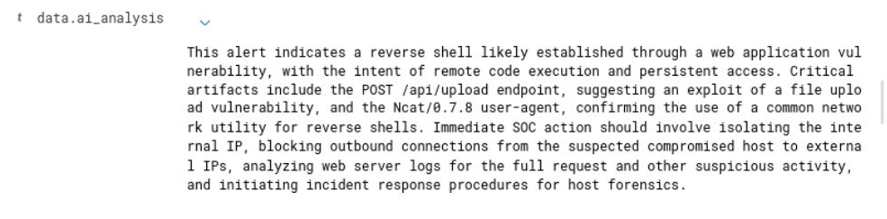
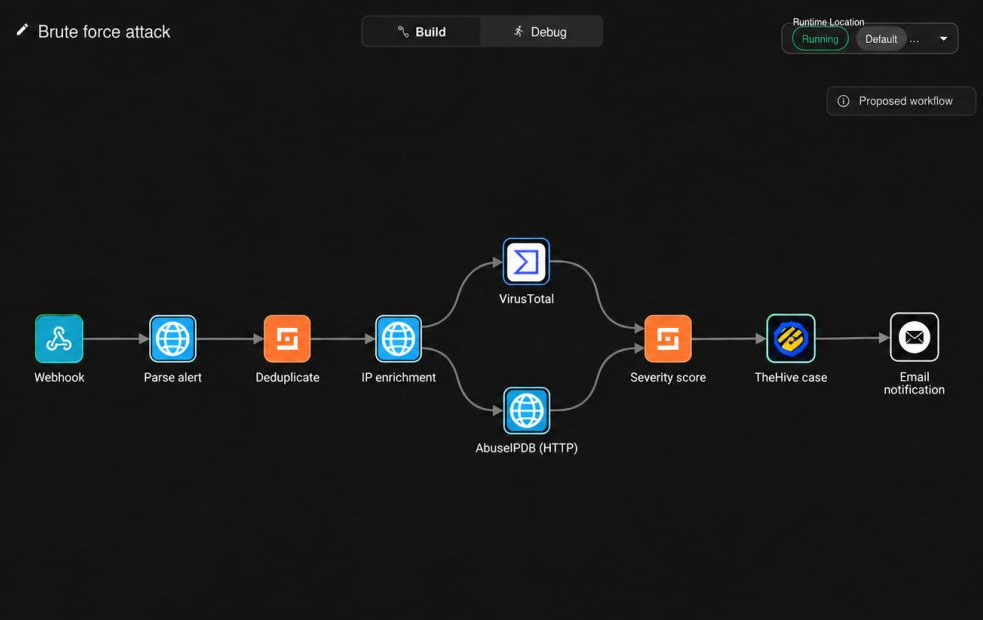

# Alert enrichment and incident workflow

## AI-assisted alert analysis

According to the report, the process is:

```text
Wazuh high-level alert
  -> select rule, network context, MITRE metadata and log excerpt
  -> Google Gemini API
  -> model-generated SOC triage suggestion
  -> indexed field: data.ai_analysis
  -> analyst review in Wazuh dashboard
```

An example output identifies a possible web compromise through a file-upload request, describes the `Ncat/0.7.8` user agent and recommends containment plus log review. This is **generated interpretation**, not a forensic finding. It should be checked against the original raw events and PCAP before response actions. The report recorded no quantified reduction in analyst triage time.



## Shuffle and TheHive

The internship report describes a `Brute force attack` workflow: Wazuh level-12 authentication alert → webhook → extract source IP → Sangfor NGAF network object / block policy → TheHive case. Its Chapter 8 states the sequence was completed, but its results discussion and conclusion describe automatic firewall blocking as future work. Without a confirmed executed action log and firewall before/after capture, this repository does **not** claim validated automated containment.

A **separate screenshot** provided after the internship shows a Shuffle visual flow with the following labels:

```text
Webhook -> Parse alert -> Deduplicate -> IP enrichment
                                   -> VirusTotal + AbuseIPDB
                                   -> Severity score -> TheHive case -> Email notification
```

The screenshot documents **workflow design/layout**. It does not establish successful production execution, successful case creation, or Sangfor NGAF block enforcement. These distinctions are intentional.



## Reproducibility and access controls

No original JSON workflow, API client, Gemini key, TheHive token or network access configuration was included in the supplied materials; none has been fabricated in this repository. To reproduce safely, export *sanitized* workflows, replace every credential with an environment variable or secret manager, and use dedicated least-privilege service accounts.
